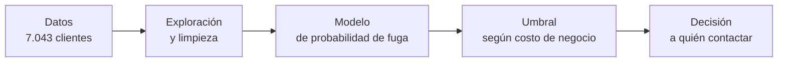
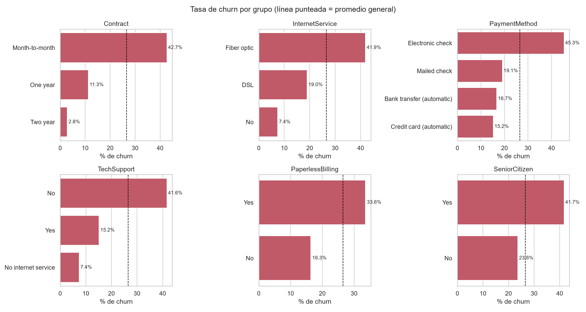
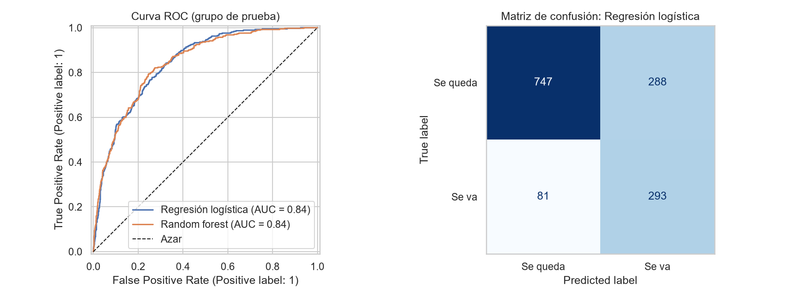
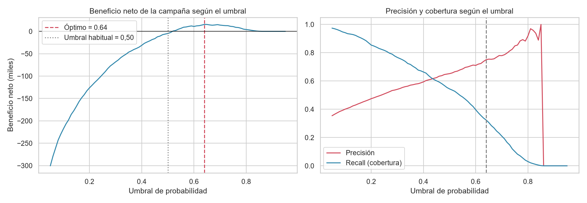
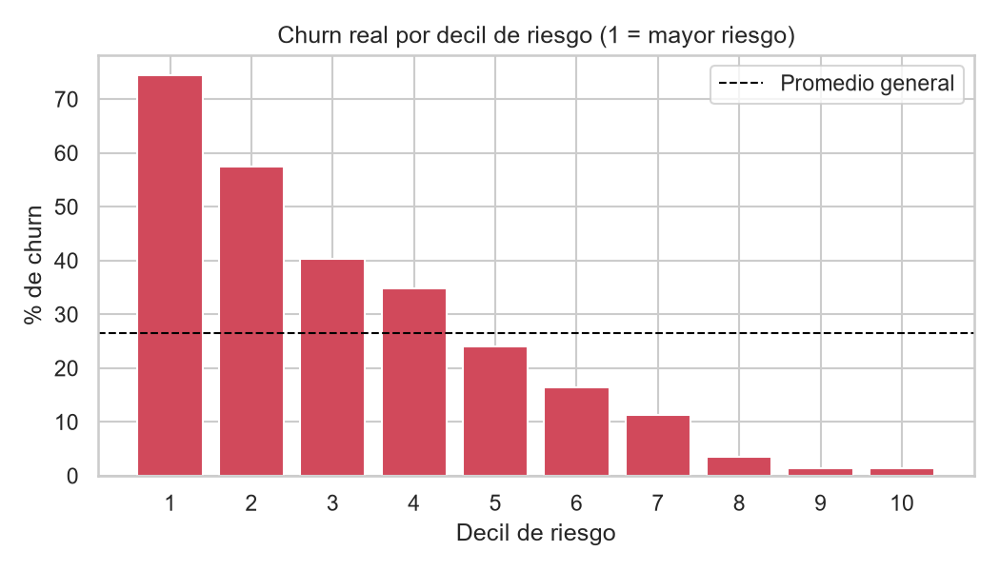

# Predicción de fuga de clientes (churn) en telecomunicaciones

Proyecto en **Python y scikit-learn** que predice qué clientes de una empresa de telecomunicaciones se van, y lo convierte en una **decisión de negocio**: a quién ofrecerle una acción de retención y cuándo conviene hacerlo.

> **Resultado clave:** el modelo ordena a los clientes por riesgo con un ROC AUC de 0,84. El 20 % de clientes de mayor riesgo concentra el **49,7 %** de las fugas, y los del decil superior se van en un **74,5 %** de los casos, frente al 26,5 % promedio.

## Pregunta de negocio

¿Qué clientes tienen más probabilidad de irse y a cuáles conviene ofrecerles una oferta de retención, teniendo en cuenta lo que cuesta esa oferta?

## Flujo del proyecto



| Notebook | Contenido |
|---|---|
| `01_exploracion_limpieza.ipynb` | Calidad de datos, limpieza y análisis del churn por segmento |
| `02_modelo.ipynb` | Tres modelos comparados, validación cruzada y variables más influyentes |
| `03_decision_umbral.ipynb` | Umbral óptimo según costos, sensibilidad a los supuestos y ranking por riesgo |

## Datos

[Telco Customer Churn](https://www.kaggle.com/datasets/blastchar/telco-customer-churn) (Kaggle): 7.043 clientes y 21 variables (servicios contratados, tipo de contrato, forma de pago, cargos y antigüedad). La variable objetivo indica si el cliente se fue: **26,5 %** de los clientes (1.869).

La licencia del dataset es "Data files © Original Authors", por lo que **no se incluye en este repositorio**. Para reproducir el proyecto, descárgalo desde Kaggle y guárdalo en `data/raw/`.

**Limpieza:** `TotalCharges` venía como texto porque 11 clientes tenían la celda en blanco. Todos tienen antigüedad 0 (recién dados de alta, sin cobros acumulados), así que el valor correcto es 0 y no un dato faltante.

## Qué distingue a quienes se van

Tasa de churn por segmento (promedio general: 26,5 %):

| Variable | Grupo de mayor riesgo | Churn | Grupo de menor riesgo | Churn |
|---|---|---|---|---|
| Contrato | Mes a mes | 42,7 % | Dos años | 2,8 % |
| Internet | Fibra óptica | 41,9 % | Sin internet | 7,4 % |
| Medio de pago | Cheque electrónico | 45,3 % | Tarjeta de crédito automática | 15,2 % |
| Soporte técnico | Sin soporte | 41,6 % | Con soporte | 15,2 % |
| Facturación sin papel | Sí | 33,6 % | No | 16,3 % |
| Adulto mayor | Sí | 41,7 % | No | 23,6 % |



Estas son asociaciones, no causas: varios grupos se solapan (por ejemplo, la fibra y el contrato mes a mes).

## Modelo

Se compararon tres modelos con un 20 % de clientes reservado como grupo de prueba (partición estratificada). Las transformaciones van dentro de un `Pipeline`, para no filtrar información de la prueba al entrenamiento.

| Modelo | Accuracy | Precision | Recall | F1 | ROC AUC |
|---|---|---|---|---|---|
| Referencia (siempre "se queda") | 0,735 | 0,000 | 0,000 | 0,000 | 0,500 |
| Regresión logística | 0,738 | 0,504 | 0,783 | 0,614 | 0,842 |
| Random forest | 0,776 | 0,560 | 0,741 | 0,638 | 0,842 |

- **La exactitud engaña:** la referencia acierta el 73,5 % sin detectar a ningún cliente que se va. Por eso se evalúa con recall, precision y ROC AUC.
- La validación cruzada (5 particiones) confirma que el resultado es estable: ROC AUC de 0,846 ± 0,012 (logística) y 0,845 ± 0,009 (random forest).
- Con rendimiento equivalente, se elige la **regresión logística** por ser más simple e interpretable. Detecta 293 de las 374 fugas del grupo de prueba (78 %), a costa de 288 falsas alarmas.
- Las variables que más suben el riesgo son la fibra óptica y el contrato mes a mes; la que más lo baja es la antigüedad.



## De la predicción a la decisión

Un modelo no decide por sí solo: hay que fijar a partir de qué probabilidad se actúa. Para eso se modela el beneficio de una campaña de retención con **supuestos de negocio explícitos y editables** (no son datos reales de una empresa):

- retener a un cliente protege 12 meses de su cargo mensual,
- la oferta cuesta un 20 % de ese valor y se entrega a todo cliente contactado,
- la oferta retiene al 30 % de quienes se iban.

El umbral se elige con probabilidades de validación cruzada del grupo de entrenamiento y se evalúa en el grupo de prueba, que no se ha usado para decidir nada.



**Resultado con los supuestos base:**

- El umbral óptimo es **0,64**, no el 0,50 habitual. Solo conviene ofrecer descuento a clientes con alta probabilidad de fuga.
- En validación cruzada contacta al 11 % de los clientes (645 de 5.634), con una precisión del 75 % y una cobertura del 32 % de las fugas.
- Con el umbral de 0,50 el beneficio es ligeramente negativo, y contactar a casi todos lo hunde (aprox. −300 mil en validación cruzada).
- En el grupo de prueba, el umbral elegido deja un beneficio neto de **3.681**, frente a 0 de no hacer nada.

**Sensibilidad:** el resultado depende de qué tan eficaz y cara sea la oferta.

| Beneficio en prueba | Costo 10 % | Costo 20 % | Costo 30 % |
|---|---|---|---|
| Éxito de la oferta 20 % | 8.469 | 0 | 0 |
| Éxito de la oferta 30 % | 27.893 | **3.681** | 0 |
| Éxito de la oferta 50 % | 83.121 | 33.735 | 10.623 |

Un beneficio de 0 significa que lo mejor es no hacer nada. El supuesto decisivo es la tasa de éxito de la oferta, que estos datos no permiten estimar: antes de una campaña masiva convendría un piloto con grupo de control para medirla.

**Ranking por riesgo:** al ordenar a los clientes del grupo de prueba de mayor a menor probabilidad y dividirlos en 10 grupos iguales, el decil de mayor riesgo se va en un 74,5 %, el 20 % superior concentra el 49,7 % de las fugas y el 40 % superior el 78,1 %.



## Limitaciones

- Los costos y la tasa de éxito de la oferta son supuestos, no datos medidos.
- Los datos son una muestra pública y estática; en un caso real habría que reentrenar y monitorear el modelo.
- Las relaciones encontradas son asociaciones y no prueban causalidad.

## Cómo ejecutarlo

```bash
git clone https://github.com/Ketrafe/churn-clientes-telco.git
cd churn-clientes-telco
python -m pip install -r requirements.txt
# descarga el dataset de Kaggle y guárdalo en data/raw/WA_Fn-UseC_-Telco-Customer-Churn.csv
# ejecuta los notebooks de la carpeta notebooks/ en orden: 01, 02, 03
```

## Estructura

```
notebooks/   exploración y limpieza, modelo y decisión de umbral
reports/     figuras generadas por los notebooks
data/        datos (no se versionan)
models/      modelo entrenado (no se versiona)
```

## Próximos pasos

- Probar un modelo de boosting y calibrar las probabilidades.
- Convertir el flujo en un script reproducible y agregar pruebas.
- Dashboard en Power BI con el ranking de clientes por riesgo.

## Autor

Kevin Labra · [LinkedIn](https://linkedin.com/in/klabras) · [GitHub](https://github.com/Ketrafe)
